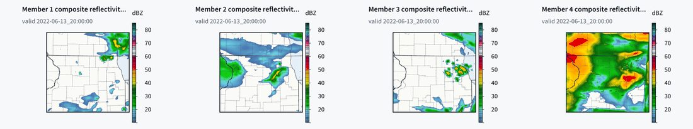

# Configuration and source rosters

`gpuwm ensemble CONFIG` accepts one ordered `[[ensemble.trajectories]]` row per named `[[ensemble.member_variants]]` row with `recipe = "member-roster"`. Existing rosters without trajectories repeat their original source request. A trajectory belongs to the member in the same position; surplus trajectories are refused because they leave configuration ownership ambiguous.

Each variant's `physics` table may select ordinary single-run physics fields. The ordinary experiment loader validates the complete resulting configuration, including dependent selectors and input requirements, before preparation. Geometry, vertical coordinates, clocks, source ownership and stochastic controls cannot be changed through this table: they would bind the wrong prepared grid or bypass a separate admission. Land selections use the ordinary soil geometry contract. A requested land change must name both `sf_surface_physics` and `num_soil_layers`.

Changing a scheme number alone need not make a valid suite. Supply its complete dependent configuration. For example, switching away from aerosol-aware Thompson must explicitly resolve its aerosol input, scalar mixing and generation selectors; changing land away from RUC must resolve RUC-only mosaics. A rejected combination keeps the ordinary loader's refusal. The dated case at `configs/cases/ensemble-upper-midwest-20220613/` gives complete explicit arms, not new defaults.



The dated case's four members two hours in (2022-06-13 20 UTC), Rust renderer
postage sheet. Panel 1: the complete HRRR recipe from HRRR at 18 UTC; panel 2:
the same recipe from RAP at 18 UTC; panel 3: Thompson, MYNN, Noah and
RRTM/Dudhia from HRRR at 17 UTC; panel 4: Morrison, YSU, RUC and RRTMGP from
RAP at 17 UTC. Two members were packed on each of two cards. The ensemble ran
end to end; its agreement with observed radar after the first hour was poor,
and panel 4 makes too much strong reflectivity, so probabilities from such
rosters are uncalibrated.

The prepared member's loaded selectors are checked against the requested arm. Its `resolved_physics` receipt reports the actual new selectors. Existing land-only receipts retain their previous shape. Memory admission prices every complete suite and ordinary packing uses the maximum member envelope. Eligible different suites may share a card through their original member runners; positive checkpoint intervals still disable same-card packing. The four-member dated case qualified a pair with different microphysics, PBL, land and radiation. This does not qualify every combination's scientific skill.

# Preserve a complete recipe at another spacing

`gpuwm domain-fit TEMPLATE` preserves the complete scientific configuration while fitting a new box. Its explicit `--root-dx KM` changes cell spacing across the original domain tree and retains the existing grid and time ratios, physics, vertical levels and clocks. Omitting the option preserves the previous behavior. The ordinary admission prices the complete configuration at the requested spacing before publishing it, with a receipt listing every change.

```sh
gpuwm domain-fit configs/recipes/hrrr_v4_gsd41.toml --root-dx 6 --point=42,-89 --point-extent-km 120 --vram-gib 32 --start-time 2022-06-13T18Z --hours 1 --out fitted-recipe-6km.toml --write
gpuwm check fitted-recipe-6km.toml --free-gib 30 --vram-gib 32
```

The clocks are preserved explicitly. Check the fitted configuration before starting a forecast at a new spacing. A fit is CPU admission and configuration emission, not a completed forecast or observation qualification. The source-derived `gpuwm domain --source hrrr` profile by itself does not emit all complete recipe settings.