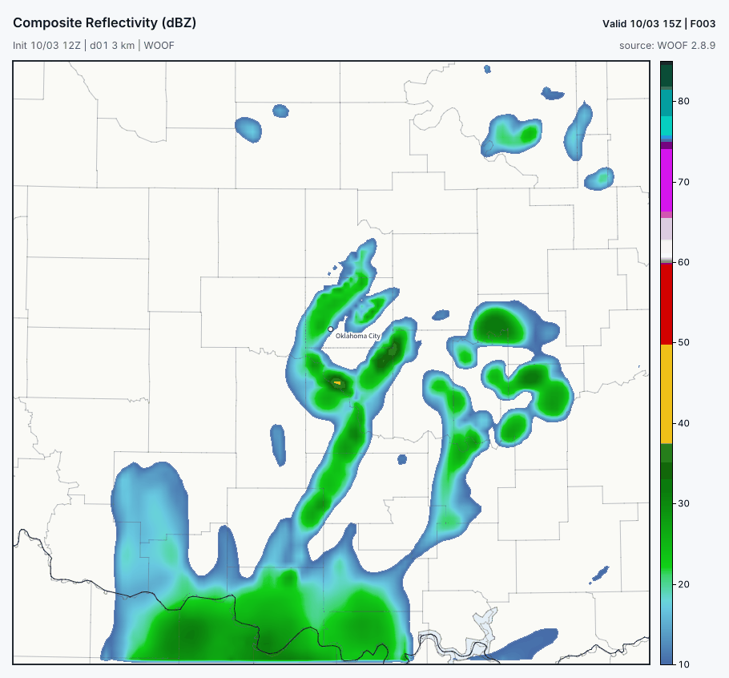
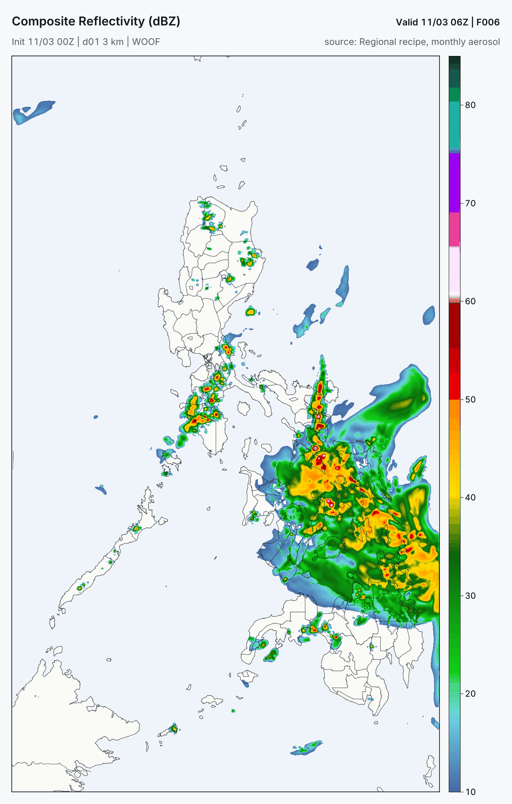
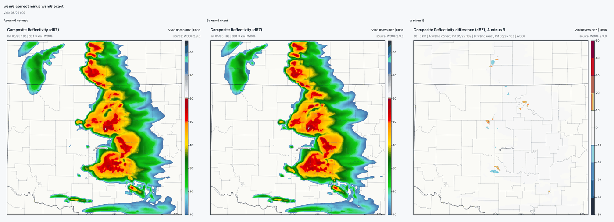
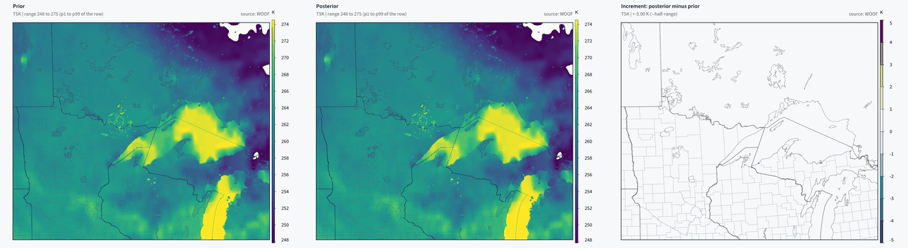
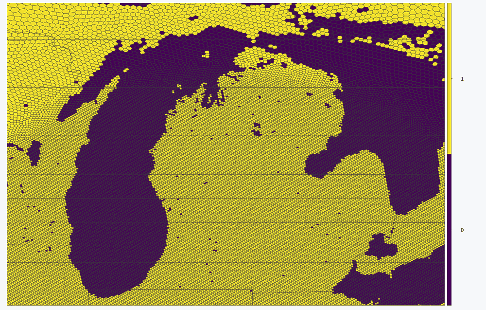

# What's new in 2.9.0

Each item below says what it does, the command that reaches it, what it was
proven on, and what it does not do yet. The full list, with every fix, is the
2.9.0 section of `CHANGELOG.md`. Pictures are reduced copies of the Rust
renderer's own maps from the runs named in their captions.

## Run a whole forecast suite from one file

*Map.* The first of two regional 3 km cycles the suite controller launched on
its own (2026-10-03 12Z start, valid 15Z), simulated radar.

- **Command:** `gpuwm suite init --region PH -o ph.suite.toml`, then
  `gpuwm suite validate ph.suite.toml` and `gpuwm suite plan ph.suite.toml`
  (all three walked on a CPU-only machine for this page: exit 0, "ADMITTED").
  `run`, `status`, `events`, `halt`, `resume`, `rehearse` and `apply` operate
  it. `gpuwm check --json` with no configuration reports the box.
- **Proven:** two real queued regional cycles with Rust maps and an
  observation scorecard; the scheduler killed mid-run resumed without
  launching a cycle twice; unknown keys, regions and rates exit 2.
- **Not yet:** the controller does not prepare inputs or measure rates itself,
  and does not span two hosts. `run` and `rehearse` refuse an unbound plan by
  name (`suite_execution_unbound`) until a `--bindings` document names the
  prepared inputs; two-host operation is refused (`suite_transport_unbound`).
- Guide: [Operate a country suite](OPERATE-A-SUITE.md).

## A full HRRR-style recipe for any region

*Map.* Six hours into a 3 km forecast over the Philippines made from the HRRR
recipe (GFS start 2025-11-03 00Z, monthly aerosol), simulated radar.

- **Command:** `gpuwm domain --recipe hrrr_v4_gsd41 --region PH --spacing-km 3 --source gfs --cycle 2025-11-03T00 --hours 6 --out country.toml`,
  then `gpuwm check country.toml` and `gpuwm go country.toml`. Regions are rows
  of a table; there is no per-country code.
- **Proven:** the Philippines run completed six hours on two cards and was
  scored against METAR stations and CMORPH satellite rain; a US control's four
  history files were byte-identical before and after the change.
- **Not yet:** outside RAP coverage the recipe uses monthly aerosol instead of
  the analysed aerosol HRRR uses, and says so in its receipt.
- Guide: [Complete recipes on a region](REGION-RECIPES.md).

## Ensembles that mix physics

*Map.* Four 3 km members two hours in (2022-06-13 18Z start): two complete HRRR
recipes from HRRR and RAP, then Thompson/MYNN/Noah/RRTM-Dudhia and
Morrison/YSU/RUC/RRTMGP, packed two per card on two cards.

- **Command:** `gpuwm ensemble CONFIG` with `recipe = "member-roster"`, one
  `[[ensemble.member_variants]]` row per member and an ordered
  `[[ensemble.trajectories]]` row per member's source.
  `gpuwm domain-fit TEMPLATE --root-dx KM` fits a complete recipe at another
  spacing.
- **Proven:** the four-member forecast ran end to end; the two unchanged
  members' final states were byte-identical to an earlier run. Members that
  use a surface recipe now compile (NVRTC refused them with "--ftz defined
  more than once"). A completed checkpointed ensemble now passes its own
  restart check.
- **Not yet:** agreement with observed radar after the first hour was poor,
  and probabilities from rosters are uncalibrated. The 16-member, 8-card
  showcase has not run.
- Guide: [Configuration and source rosters](../ensemble-configuration-rosters.md).

## Stochastic physics runs, with warnings

SPPT, SKEBS, SPP (for Grell-Freitas, MYNN surface and boundary layer, and RUC)
and uniform initial-wind perturbations now run, with loud warnings and a
receipt per run, instead of being refused for uncalibrated spread. With every
option off, output is byte-identical. `rand_perturb`, `multi_perturb` and
`perturb_bdy` are refused by name, naming the fields no scheme consumes.

- **Command:** an `[ensemble.stochastic]` table (`sppt = true`,
  `skebs = true`, `[ensemble.stochastic.spp]`) in an ensemble configuration,
  or the `&stoch` selectors of an imported WRF namelist; uniform initial-wind
  perturbations are `[ensemble.perturbation] kind = "uniform-wind"`.
- **Guide:** [WRF stochastic import](../ensemble-wrf-stochastic-import.md).
- **Proven:** 13 GPU forecast and receipt cells and a nonzero Grell-Freitas
  SPP check passed; all 249 all-off arrays equal 2.8.9's.
- **Not yet:** spread from these options is not calibrated against
  observations. No map set was rendered for this release.

## The engine for gpuwm-hex 0.4.0

gpuwm 2.9.0 carries what the global model needs: the generic MPAS column
physics entry, New Tiedtke at each cell's own spacing, the ICON global source,
the product renderer pieces (including the `global-mesh` and `region:NAME`
render windows hex's product views ask for) and the RRFS v2 preset lookup
through the installed gpuwm-hex. See [gpuwm with gpuwm-hex](WITH-GPUWM-HEX.md).

## Tools back in the wheel, and a smaller install

`rw_simradar`, `rw_mlexport` and `rw_globe_pack` ship in the platform wheels
again, so simulated radar, ML export and the globe packer work straight after
`pip install`. The six renderer programs are one binary with small launchers;
the Linux wheel is about 96.0 MB with all 48 tools, and 73 rendered
images were pixel-identical to the previous renderer.
`gpuwm fetch-bridges --partial --artifact NAME` fetches only the named tools.
`gpuwm ml-export` writes planes larger than 1024 x 1024 cells in 512 x 512
tiles by default, so a training loader reading a patch decompresses only the
tiles it touches; values are unchanged. gpuwm-hex soundings, meteograms and
maps read the initial state and each history frame once: on a 1.47
million-cell 20 km global mesh the point stage took 42 s instead of 2,150 s,
with identical pictures.

## The WRF namelist door refuses what it cannot run

`gpuwm import-namelist` used to swap some settings for others without saying
so. It now refuses them by name: ISHMAEL microphysics (`mp_physics = 55`, it
ran Morrison), the operational fork's radar latent heating
(`mp_tend_radar = 1`), the solar eclipse option when an eclipse falls inside
the run, HAILCAST (`hailcast_opt = 1`), the digital filter (`dfi_opt` other
than 0) and any `&chem` setting WOOF's chemistry cannot carry. So the
unmodified NOAA HRRR namelist is refused, naming its four smoke settings and
`hailcast_opt`.

- **Command:** `gpuwm import-namelist namelist.wps namelist.input --output case.toml`.
- **Proven:** the door tests and a Registry-wide audit that finds no setting
  without a recorded decision; table in
  [CONFIGURATION.md](CONFIGURATION.md) ("What a WRF namelist setting becomes").
- **Not yet:** HAILCAST and the digital filter are not ported.

## More WRF physics to choose from

Six microphysics schemes (Purdue Lin 2, WSM3 3, WSM5 4, Ferrier-Aligo 5, WSM7 24
and the revised WSM6 106), two cumulus schemes (Grell 3D 5 and New SAS with
its shallow convection 96), New Goddard radiation (5 for both bands), WRF's
binary cloud fraction (`icloud = 2`), aerosol options 1 and 2 and WRF's
lightning package. MYNN TKE advection is allowed.

- **Command:** the ordinary selectors in a configuration (`mp_physics`,
  `cu_physics`, `ra_lw_physics`/`ra_sw_physics`, `icloud`, `aer_opt`,
  `lightning_option`, `bl_mynn_tkeadvect`), or the same keys in an imported WRF
  namelist.
- **Proven:** each scheme matches WRF v4.6.1's own Fortran word for word on its
  committed column sets. These new options do not affect forecasts that do not
  select them. Default forecasts still differ from 2.8.9 because the WRF
  4.7/4.8 correctness fixes below are on by default.
- **Not yet:** no observation scores for these schemes, so no preset recommends
  them. The WRF radiation and cumulus values that are not ported are refused by
  name.

Lightning's producer requirements and remaining combination checks are listed
in [Lightning producers and named gaps](../lightning-availability.md).

## WRF 4.7 and 4.8 fixes, on by default

The solar equation of time and YSU's capped top-down entrainment (WRF 4.8),
Noah-MP snow ageing at night (4.7) and the urban rain-evaporation water balance
(4.8) are on by default, as in WRF. Each matches the WRF release that carries
it word for word on its oracle columns.

- **This changes default output.** On the physics-lane 1 h case, 48 of 158 history fields
  move; 2 m temperature by up to 1.12 K and surface shortwave by up to
  90.7 W/m2. On the release-gate 1 h case, 41 of 80 fields differ
  (9,949,020 values), with surface shortwave changing by up to 183.6 W/m2.
- **The old behaviour:** set `solar_generation`, `ysu_version` and
  `noahmp_snow_age` to `wrf_461`, and `urban_water_balance` to `wrf_471`.
  The release-gate case (Thompson, YSU, Noah, no urban scheme) run with the
  first three set back reproduces 2.8.9 exactly. This is a case-specific
  result, not a claim for every physics configuration.

## Correct mode is the default

*Map.* Simulated radar 6 hours into a 3 km Southern Plains forecast (2024-05-25
18Z start) with WSM6: correct mode, exact mode, and their difference. The squall
line, its bowing segments and the trailing rain are the same; the runs differ
by single cells shifted a grid point or two.

Two water-budget defects that WRF and MPAS carry are fixed by default. WSM6
and WDM6 booked rain falling below ground in a sloped layer at the flat layer
mean, and New Tiedtke added tendencies per unit of moist-air mass to mixing
ratios carried on dry mass. Thompson (`mp_physics = 8`) also books the cloud
water that settles out of the lowest level in a new total, `CLOUDNC`, instead
of losing it.

- **Command:** nothing; it is the default. `physics.mode = "exact"` (or the
  per-scheme keys in `CONFIGURATION.md`) computes what the engine computed
  before the corrections. Strict WRF mode (`GPUWM_WRF_EXACT=1`) forces exact,
  and every run receipt names the mode and the corrections that reached each
  domain.
- **Proven:** on that 6 h case, exact mode is bit-identical to the engine
  before the switch for Thompson and WSM6 at every hour. Thompson in correct
  mode matches exact in every shared field, plus `CLOUDNC`. WSM6 differs only
  in surface rain and canopy water in the first hour; after that the storms
  drift as they would from any tiny perturbation, and 6 h domain rain differs
  by under 1% with no consistent sign. On a 1 h global hex run with WSM6 and
  New Tiedtke, rain is about 0.2% lower.
- **Not yet:** aerosol-aware Thompson (`mp_physics = 28`, the HRRR default) and
  WSM3, WSM5 and WSM7 carry the same defects and are not corrected yet.
- A 2.8.9 WSM6, WDM6 or New Tiedtke checkpoint resumes only in exact mode, and
  is refused by name, with the setting that resumes it, under the new default.

## GFS starts prepared the way WPS prepares them

*Map.* Skin temperature over the upper Midwest and Ontario from a 3 km GFS
start (2026-03-02 12Z), drawn with the renderer's before/after layout: WPS 4.6.0
and real.exe 4.7.1 ("prior"), ours ("posterior"), and ours minus theirs on a
5 K scale. The difference panel is blank apart from one cell where the two land
masks disagree.

GFS lakes now take skin temperature and ice from GFS water by WPS's own
search; RH and 2 m RH are converted with WPS's mixed-phase rule on the root
and on every nest; snow follows WPS (SNOW = 2 x WEASD); and a pressure level
above the model top is fetched.

- **Command:** nothing; it is the default for every GFS start.
  `[case_data] gfs_lake_skin = "air_temperature"` and
  `gfs_snow_convention = "raw"` keep the alternatives.
- **Proven:** against WPS 4.6.0 and real.exe 4.7.1 on a CONUS 3 km GFS case,
  skin temperature RMS is 0.029 K over the domain (2.8.9: 0.252 K) and 0.156 K
  over lakes. On a 1 km nest over the Boundary Waters lakes, the nest's 2 m
  humidity RMS went from 6.5e-5 to 8.4e-9 kg/kg.
- **Changes:** GFS preparations rebuild once, an older GFS pressure subset
  without the level above the top is fetched again, and `gfs_grib2_bridge`
  must be rebuilt (an older one is refused).
- **Not yet:** a lake that GFS does not resolve takes distant GFS water, as in
  WPS, so in early spring some frozen lakes start as open water near 273 K. A
  lake surface analysis is the real remedy.

## Native MPAS statics, with lakes as water

*Map.* Land mask of a 3 km regional MPAS static built by 2.9.0 over the Great
Lakes: water is dark. The static built by 2.8.9 for the same mesh had every
one of these lakes as land.

`rw_mpas_static` now writes the static that MPAS-A v8.4.2 itself builds from
an empty namelist: 79 variables, MODIS land use in which a lake is water, and
MPAS's own gravity-wave-drag statistics.

- **Command:** `gpuwm mesh` and the hex preparation build it by default.
  `gpuwm fetch-geog --datasets mesh` stages the two land-use archives it reads.
  `rw_mpas_static --legacy-static` keeps the old stream.
- **Proven:** on that mesh 15,412 lake cells were stored as land before; the
  native static has none, and its land categories and shorelines match the
  lake-fix rule cell for cell apart from 45 more water cells.
- **Changes:** every default static changes, and a cached static rebuilds once
  (its schema marker moved).

## Fixes you may see in output

- Kain-Fritsch accumulated convective rain can no longer step backwards in
  columns where the downdraft evaporates all of it. Default output changes only
  in such columns.
- RRTMGP keeps positive layers above the model top when a column top sits
  below its pressure ladder (non-finite longwave heating on hex meshes).

- Eight schemes in everyday use now match WRF v4.6.1 word for word:
  Kain-Fritsch, WSM6, Kessler, Dudhia shortwave, RRTM longwave, MYJ,
  Milbrandt-Yau and WDM6. Each was measured missing WRF before (Kain-Fritsch
  matched none of 1,793 convecting columns). Every run that selects one of them
  changes, including the default 12 km root, which uses Kain-Fritsch.
- YSU on a calm column now builds WRF's boundary layer (703 m on the test
  column) instead of a one-level one, and Noah runs land-ice points instead of
  leaving them frozen.

None has a before/after map yet; each is proven by column tests against WRF's
own Fortran.

Also fixed:

- Hex maps reduce sea-level pressure the way the GFS analysis does. The WRF
  method used before read up to 58 hPa low over Antarctica, Greenland and high
  terrain; globe RMS against GFS went from 4.04 to 0.71 hPa. ArWen's own WRF
  maps do not change.
- Noah sea ice now evolves through WRF's own sea-ice step; its skin
  temperature used to stay at its starting value. Proven against WRF's code on
  its oracle columns; no case with sea ice has been run yet.

- An imported WRF namelist that leaves out `top_lid` now gets WRF's open top,
  as wrf.exe does, instead of a rigid lid. Proven by a 12 h one-domain CONUS
  12 km run with each lid; configurations ArWen writes are unchanged.

## Not in 2.9.0, with the reason

See the "Not in this release" list in `CHANGELOG.md`; each entry names its
reason.
